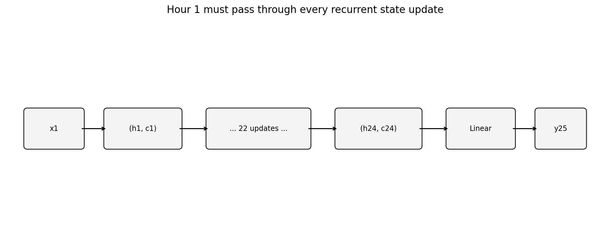
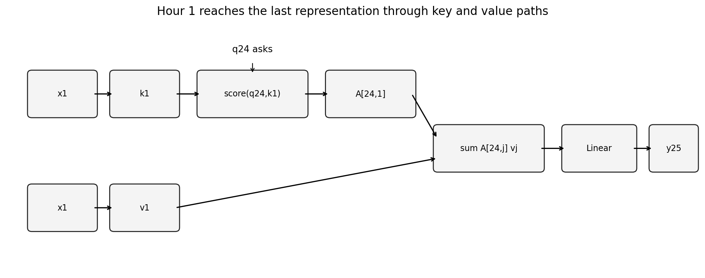
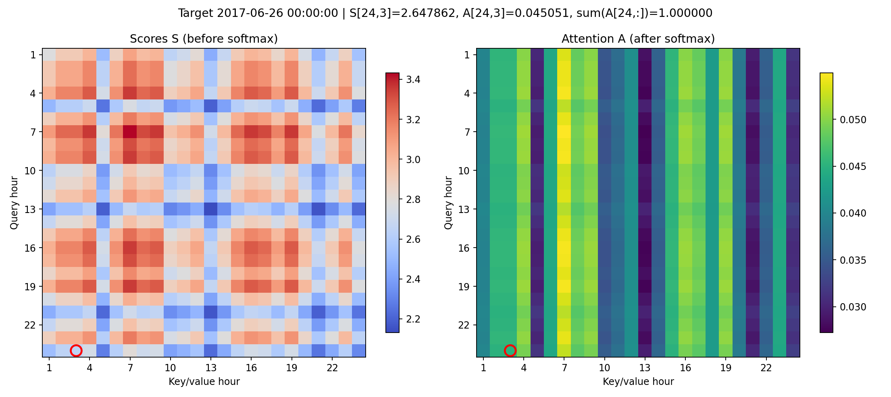

# week08：从 LSTM 到单头自注意力

使用与 week07 完全相同的 ETTh1 数据、24 小时窗口、训练/验证划分和训练标准化统计量，只改变读取历史的方式。本周三项实践均按“动手”完成：训练单头缩放点积自注意力、替换末位注意力权重、交换两个小时并加入简化位置编码。

## 环境与运行

- Python 3.10.16、PyTorch 1.13.1 CPU、NumPy 1.26.4、pandas 2.3.3、Matplotlib 3.10.9。
- 数据复用 `../week06/data/ETTh1.csv`；week07 的 LSTM 验证指标读取自 `../week07/results/metrics.csv`。
- 输入只含 `OT`，本周模型不使用测试集；随机种子 42，批次 128，Adam 学习率 0.001，训练 40 轮。

在 `week08` 目录运行：

```bash
python run_attention.py
```

入口会一次生成模型、表格和三张规定图片。关键接口是 `SingleHeadAttentionPredictor.inspect_forward(inputs, add_position=False)`：一次返回预测、输入映射、Q、K、V、S、A 和 Z，使图和数值来自同一次前向计算。`predict_with_reading` 则只替换 softmax 后的末位权重，保持 V 和预测层不变。

| 文件 | 职责 |
| --- | --- |
| `data.py` | 读取 ETTh1、构造窗口、按目标时间划分并用训练统计量标准化 |
| `models.py` | 输入映射、Q/K/V、缩放点积、softmax、加权读出和预测层 |
| `training.py` | 训练 40 轮、保存最佳验证参数并记录首批梯度观察 |
| `evaluation.py` | 三种读法的批量预测及原始尺度 MAE、RMSE |
| `reporting.py` | 保存长表，绘制损失曲线、S/A 热图和两张路径图 |
| `run_attention.py` | 编排三项实践、程序核对和产物保存 |

## 实践一：从循环路径到单头自注意力

### 运行前的想法

LSTM 只能把第 1 小时的信息写入状态，再依次经过第 2 至第 24 步的状态更新，最后由 `h24` 进入预测层。我的改法是让第 24 小时生成查询 `q24`，直接与每个小时的键比较，并用得到的 24 个权重汇总 V；这样第 1 小时能分别通过 `k1` 的匹配路径和 `v1` 的内容路径影响末位表示，不必经过中间 23 次循环更新。





模型对一个批次执行：

```text
X = Linear(OT)                 # (batch, 24, 16)
Q, K, V = Linear(X)            # 各为 (batch, 24, 16)
S = Q @ K^T / sqrt(16)         # (batch, 24, 24)
A = softmax(S, dim=-1)         # 每一行沿被查询小时归一化
Z = A @ V                      # (batch, 24, 16)
y_hat = Linear(Z[:, -1, :])    # (batch, 1)
```

模型共 865 个参数，最佳轮次为第 37 轮。训练时段统计量为 `mean=17.128262`、`std=9.176491`。首批在 `backward()` 后，Q/K/V 三个权重梯度范数分别为 `0.015163 / 0.023007 / 4.560299`；此时 V 层参数尚未变化，执行 `step()` 后才变化。这说明同一损失确实沿 A 路径更新 Q/K，也沿 V 路径更新 V。

### 同一验证窗口的 S/A 核对

所选窗口为 2017-06-25 00:00 至 23:00，预测目标时间为 2017-06-26 00:00。第 1、24、25 小时油温分别为 `21.2450 / 20.7520 / 20.9630`。



- `S[24,3]=2.647862`，`A[24,3]=0.045051`。
- `A[24,:].sum()=1.000000`。
- 用 `A[24,:] @ V` 还原 `Z[24]` 的最大绝对误差为 `0`。
- 本窗口原模型预测为 `20.558066`。

第一版模型只由油温内容生成 Q/K/V。若两个位置的油温相同，它们会生成相同的键和值；同一个 `q24` 不能因“升温途中/降温途中”而给它们不同权重。模型能看见窗口中有哪些值，却看不见这些值原本处于哪个小时。

## 实践二：替换末位注意力权重

### 运行前判断（保留）

1. 平均读得到 24 行 V 的逐分量平均；若各小时 V 接近，预测可能只小幅变化。
2. 只读最后一小时得到 `V[24]`，仍需经过训练好的线性预测层和反标准化；它不是直接拿第 24 小时真实油温当预测。
3. 仅凭权重无法判断哪种替换偏离原预测更多，还要查看 V 的差异及预测层方向。

程序核对全部通过：原权重手动汇总还原原预测；平均读上下文等于 `V.mean(dim=1)`；只读末小时上下文等于 `V[:, -1, :]`，最大绝对误差均为 `0`。

| 目标时间 | 真实油温 | 原权重预测 | 平均读预测 | 只读最后一小时预测 |
| --- | ---: | ---: | ---: | ---: |
| 2017-06-26 00:00 | 20.962999 | 20.558066 | 20.505847 | 20.030359 |

在这个窗口上，只读最后一小时偏离原预测最多；它也离真实值更远。但单窗口结论不能代替整段验证集评价。

| 模型或读法 | 验证样本数 | MAE | RMSE |
| --- | ---: | ---: | ---: |
| 第七周选定 LSTM (`lstm_h32`) | 2880 | **0.597546** | **0.914153** |
| 本周自注意力，原权重 | 2880 | 1.238918 | 1.594348 |
| 同一模型，平均读 | 2880 | 1.497818 | 1.966358 |
| 同一模型，只读最后一小时 | 2880 | 0.862232 | 1.138600 |

原权重优于平均读，却不如强制只读末小时，更不如 LSTM。这只能说明“按当前结构、初始化与训练设置学到的权重”没有在验证集上形成更好的读法，不能推断自注意力一般不适合时间序列，也不能拿替换结果重新选择或训练模型。

## 实践三：交换两个小时并加入位置

交换窗口中的第 3 与第 18 小时：

- 第 3 小时：2017-06-25 02:00，`OT=21.525999`。
- 第 18 小时：2017-06-25 17:00，`OT=21.385000`。

### 运行前判断（保留）

末小时输入不变，因此 `q24` 不变。未加位置时，两组键和值只随内容对调，对应权重也对调，整个加权和与预测应在浮点误差内不变。加位置后，位置向量留在原时刻，内容与位置的配对改变，所以末位表示和预测可能改变。

| 模式 | 原排列预测 | 交换后预测 | 原始尺度绝对差 |
| --- | ---: | ---: | ---: |
| 未加位置 | 20.558066 | 20.558066 | 0.000000 |
| 加入简化位置 | 20.561390 | 20.560833 | 0.000556 |

未加位置时，末位查询最大差为 `0`，被交换的两项权重随内容精确互换，末位上下文只差 `5.96e-08`。加入位置后，位置数仍留在第 3 和第 18 格，键和值不再只是整对交换，预测因而出现非零变化。变化很小不代表位置无效：这里复用了未按位置编码训练的参数，只检查结构是否具备区分排列的能力。

## 结论与口头讲解

1. LSTM 的第 1 小时必须沿状态链走到 `h24`；自注意力让 `q24` 直接与 `k1` 匹配，并把 `v1` 加入末位汇总。
2. A 回答“给谁多少权重”，V 提供“实际取回什么”，Z 才是交给预测层的 16 维表示；权重大幅变化不保证预测大幅变化。
3. 本次模型的原权重没有胜过 LSTM或强制末位读法。结构提供了路径，但是否学好必须用独立验证误差检查。
4. 不加位置时，自注意力末位读出对前 23 小时的排列是置换不变的；位置必须在生成 Q/K/V 之前加入，才能改变“内容和位置”的配对。

原任务中的提问与逐题答案见 [第八周任务问题解答.md](第八周任务问题解答.md)。学习时请先看 [学习指南.md](学习指南.md) 的四段讲解，再独立完成其中的自测。全部学习资料和可打印版本放在 [学习支持](学习支持/)；实际掌握状态在你提交自测答案前保持“待验证”。

## 结果文件

- `selected_attention.pt`：最佳模型参数、模型维数、最佳轮次和标准化统计量。
- `metrics.csv`：LSTM 与三种注意力读法的同批验证指标。
- `predictions.csv`：三种读法的 8,640 条逐目标预测。
- `single_window.csv`、`attention_window.csv`：单窗口预测与 24×24 的 S/A 数值。
- `swap_predictions.csv`、`checks.json`：交换实验与所有程序核对。
- `loss_curves.png`、`lstm_path.png`、`attention_path.png`、`scores_weights_heatmap.png`：提交图片。

测试集未用于模型选择、比较或本周结论。
