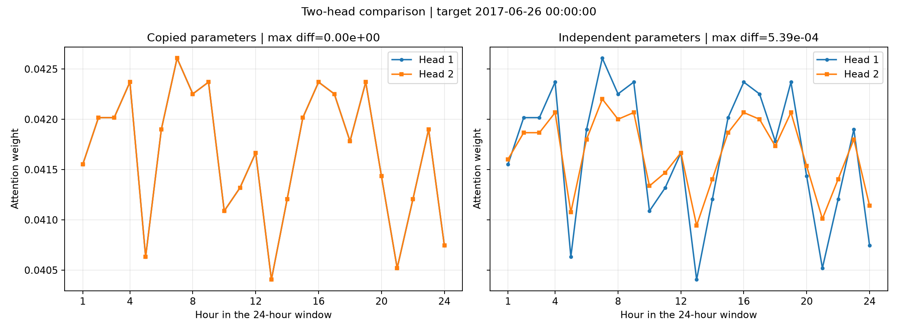
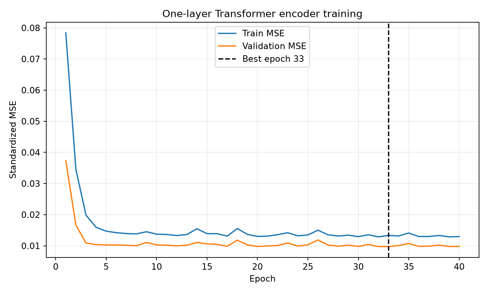

# week10：读懂并组装一层 Transformer 编码器

本周沿用 week08 的 ETTh1 油温任务：读取过去 24 小时，预测第 25 小时。代码先用可控对照拆开双头注意力与因果遮罩，再按经典结构图左侧的顺序组装一层编码器：

```text
OT → input projection + position → two-head attention → Add & Norm
   → feed-forward → Add & Norm → 第 24 行 → linear → 第 25 小时 OT
```

所有图表和数值均由本目录代码生成。测试集没有用于选型、调参或结论。

## 环境与运行

- 实际运行环境：Python 3.12.14、PyTorch 2.5.1 CPU、NumPy 2.5.4、pandas 3.1.0、scikit-learn 1.9.1、Matplotlib 3.11.2。
- 数据：`../week06/data/ETTh1.csv`，只使用 `OT`；按预测目标时间沿用 week08 划分。
- 训练：seed 42、batch 128、Adam 0.001、40 轮；只用训练时段计算 `mean=17.128262`、`std=9.176491`。

在 `week10` 目录运行：

```bash
../.venv-week05/Scripts/python.exe run_transformer.py
../.venv-week05/Scripts/python.exe -m unittest -v test_week10.py
../.venv-week05/Scripts/python.exe predict_window.py --validation-index 0
```

第一条验证窗口的目标时间为 `2017-06-26 00:00:00`。载入最佳模型后，编码器输出为 `(1, 24, 16)`，取末行后为 `(1, 16)`，再得到一个 `(1, 1)` 预测。

| 文件 | 职责 |
| --- | --- |
| `data.py` | 读取、窗口化、按目标时间划分，只用训练时段标准化 |
| `models.py` | 单头、双头、位置、残差、LayerNorm、前馈和预测层 |
| `training.py` | 训练 40 轮，按验证 MSE 保存最佳参数并检查梯度路径 |
| `evaluation.py` | 批量预测和 sklearn 原始尺度 MAE/RMSE |
| `reporting.py` | 保存长表并画双头对照图、损失曲线 |
| `run_transformer.py` | 编排实践四至六并执行关键断言 |
| `predict_window.py` | 恢复最佳模型并预测任意验证窗口 |
| `test_week10.py` | 快速验证复制参数、因果遮罩和编码器形状 |

## 实践四：同一个窗口，读两遍

两个头都执行 `16 → 8` 的 Q/K/V 投影。先把第一头全部参数复制给第二头，再保持第一头不变、换成独立初始化的第二头。



| 对照 | 第 24 行权重最大绝对差 | 第 24 行读出最大绝对差 |
| --- | ---: | ---: |
| 输入和参数完全相同 | 0 | 0 |
| 输入相同、第二头独立初始化 | 0.000539 | 1.864619 |

独立参数时两排权重非常接近，仍应保留实测结果：随机初始化只说明结构允许不同读法，不能把尚未训练的头解释为“升温头”或“降温头”。这次读出差异大于权重差异，也提醒我们：`A` 决定取多少，`V` 决定取回什么，不能只看权重判断内容差异。

每个头得到 `(1, 24, 8)`，沿最后一维拼接为 `(1, 24, 16)`，输出投影后仍为 `(1, 24, 16)`。因此 Multi-Head Attention 不会消掉 24 个时间位置。

原始数值见：

- `results/practice4_comparison.csv`
- `results/practice4_weights.csv`

## 实践五：因果遮罩阻断未来信息

复制同一条标准化窗口，只把第 18 小时的标准化油温加 1；两份输入经过同一输入映射和同一套双头参数。观察第 6 行：

| 遮罩 | 第一头第 6 行给第 18 小时的权重 | 未来列最大权重 | 整行权重和 | 两输入第 6 行输出最大绝对差 |
| --- | ---: | ---: | ---: | ---: |
| 关 | 0.041785 | 0.042627 | 1.000000 | 0.013831 |
| 开 | 0 | 0 | 1.000000 | 0 |

实现顺序是先把对角线上方的分数设成 `-inf`，再沿最后一维做 softmax。若先 softmax 再清零，未来位置已经进入分母，保留下来的权重不再合计为 1，未来信息仍能影响结果。

翻译时，右下的 Masked Multi-Head Attention 只能读取已经生成的中文词；右侧中间的交叉注意力再用译文侧查询读取完整英文。油温任务在第 24 小时末预测第 25 小时，窗口内 24 个观测都已经发生，所以实践六关闭窗口内因果遮罩。

原始数值见 `results/practice5_mask_comparison.csv`。

## 实践六：组装并训练一层编码器

`TransformerEncoderPredictor.encoder_tensors()` 直接暴露结构图上的路径：

| 张量 | 形状 | 图中含义 |
| --- | --- | --- |
| `X` | `(B, 24, 16)` | 输入映射加位置 |
| `M` | `(B, 24, 16)` | 双头注意力合并、输出投影 |
| `H` | `(B, 24, 16)` | `norm1(X + M)` |
| `F` | `(B, 24, 16)` | `16 → 32 → ReLU → 16` 逐行前馈 |
| `E` | `(B, 24, 16)` | `norm2(H + F)` |
| `E[:, 23, :]` | `(B, 16)` | 第 24 行，交给预测层 |
| 预测 | `(B, 1)` | 标准化第 25 小时油温 |

第一批 `backward()` 后，第一头 Q 投影梯度范数为 `0.007405`，末端预测层梯度范数为 `5.840683`；两处参数都在 `step()` 前不变、在 `step()` 后改变，说明同一个损失确实连通了整层参数。

模型共 2,273 个可训练参数，最佳轮次为第 33 轮。



### 同批验证集指标（原始油温尺度）

| 模型 | 验证 MAE | 验证 RMSE | 结果来源或最佳轮次 |
| --- | ---: | ---: | --- |
| 最近值基线 | 0.608238 | 0.925271 | 同一批验证目标 |
| 第七周 LSTM | 0.597546 | 0.914153 | week07，最佳轮次 39 |
| 第八周单头注意力 | 1.238918 | 1.594348 | week08，最佳轮次 37 |
| 第十周单层编码器 | **0.594753** | **0.905675** | week10，最佳轮次 33 |

本次单层编码器在这两个验证指标上略优于三项对照，但这只是固定划分、固定随机种子和本次训练配置下的结果；它不证明 Transformer 一般优于 LSTM，也没有使用测试集确认泛化。

## 从结构图走回代码

任选一行，例如第 6 小时：

1. `input_projection + simple_position_encoding` 生成这行的 16 个输入特征。
2. `TwoHeadAttention` 让这行分别用两个查询读取 24 行，再拼接、混合成 `M` 的第 6 行。
3. `norm1(X + M)` 把原表示和读回内容相加；这是第一条绕行箭头。
4. `feedforward` 只加工第 6 行手里的 16 个特征，不在行之间传递信息。
5. `norm2(H + F)` 是第二条绕行箭头；24 行仍全部保留。
6. 只有编码器完成后才取第 24 行，由 `predictor` 输出一个油温。

翻译模型右侧则不以油温线性层结束：解码器顶部把每个候选词的分数经 softmax 变为概率，选择或采样下一个词，再继续生成。

## 学习与验收

先看 `学习指南.md` 的六道诊断题，再在不运行代码的情况下回答；随后运行单元测试、重跑三项实验，并逐项解释两张图和两张表。知识范围、验收条件和 4–5 小时学习安排见 `学习支持/知识清单.pdf` 与 `学习支持/备考计划.pdf`。在你提交诊断题答案前，掌握状态保持“待验证”。

## 结果文件

- `selected_transformer_encoder.pt`：最佳模型参数、维数、最佳轮次和标准化统计量。
- `checks.json`：双头、遮罩、形状与首批梯度的集中核对。
- `practice4_comparison.csv`、`practice4_weights.csv`：实践四差值和两排权重。
- `practice5_mask_comparison.csv`：实践五开关对照。
- `shape_trace.csv`：实践六单窗口逐层形状。
- `history.csv`、`metrics.csv`、`predictions.csv`：训练历史、指标和验证预测。
- `practice4_head_comparison.png`、`loss_curves.png`：提交图片。

测试集未用于模型选择、比较或本周结论。
